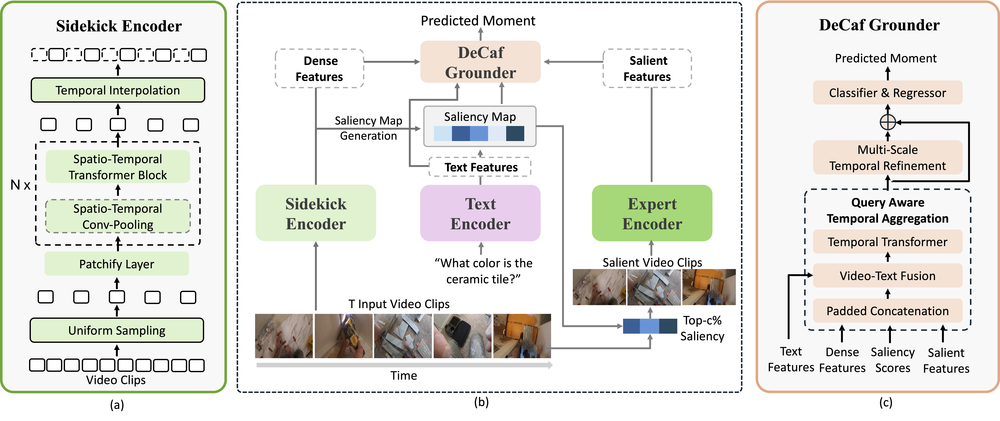
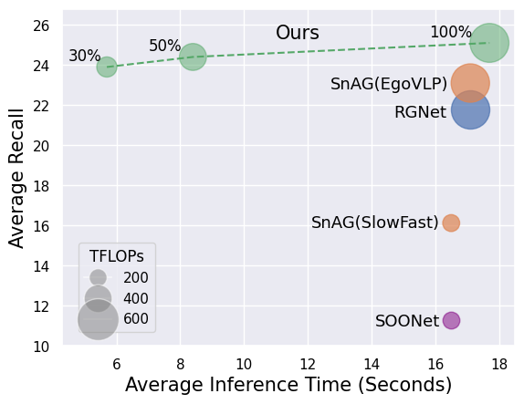

<!-- # CVPR2025-DeCafNet -->
<h2 align="center"> <a href="https://openaccess.thecvf.com/content/CVPR2025/html/Lu_DeCafNet_Delegate_and_Conquer_for_Efficient_Temporal_Grounding_in_Long_CVPR_2025_paper.html">DeCafNet: Delegate and Conquer for Efficient Temporal Grounding in Long Videos</a></h2>

Official Repo for our CVPR 2025 long-temporal grounding paper.

[](https://paperswithcode.com/sota/temporal-sentence-grounding-on-charades-sta?p=decafnet-delegate-and-conquer-for-efficient)
[](https://paperswithcode.com/sota/temporal-sentence-grounding-on-ego4d-goalstep?p=decafnet-delegate-and-conquer-for-efficient)
[](https://paperswithcode.com/sota/video-grounding-on-mad?p=decafnet-delegate-and-conquer-for-efficient)
[](https://paperswithcode.com/sota/natural-language-queries-on-ego4d?p=decafnet-delegate-and-conquer-for-efficient)
[](https://paperswithcode.com/sota/natural-language-moment-retrieval-on-mad?p=decafnet-delegate-and-conquer-for-efficient)
[](https://paperswithcode.com/sota/natural-language-moment-retrieval-on-tacos?p=decafnet-delegate-and-conquer-for-efficient)



<p align="center">
    
</p>

## TODO
- [x] Upload data and model checkpoints
- [ ] Release code for side-kick encoder training.

## Installation
1. Set up the environment with conda:
    ```bash
    conda env create -f environment.yml
    conda activate decafnet
    ```

2. Install NMS
    ```bash
    cd ./libs/nms
    python setup_nms.py install --user
    ```

## Data
1. Download processed data from [Google Drive](https://drive.google.com/drive/folders/1Dq9gb7NxN3P8SomuSKVbiOkWNMNPZoZI?usp=sharing).

2. Update data paths in config YAMLs under `libs/core/` to match your local filesystem.
   Common fields to check are:
   - `data.anno_file`
   - `data.vid_feat_dir`
   - `data.text_feat_dir`
   - `data.text_cls_fname`
   - `data.clip_token_fname`
   - `data.sidekick_vid_feat_dir` / `data.sidekick_vid_load` (for Ego4D-NLQ / GoalStep)

3. Available experiment configs:
   - Ego4D-NLQ: `libs/core/ego4d_nlq_30.yaml`, `libs/core/ego4d_nlq_50.yaml`, `libs/core/ego4d_nlq_100.yaml`
   - GoalStep: `libs/core/goalstep_30.yaml`, `libs/core/goalstep_50.yaml`, `libs/core/goalstep_100.yaml`
   - MAD: `libs/core/mad.yaml`
   - Charades-STA: `libs/core/charades_i3d.yaml`
   - TACoS: `libs/core/tacos.yaml`

## Training
Launch experiments using train.py and config YAMLs under `libs/core/`.
```bash
# example, train decaf-grounder on Ego4D-NLQ dataset with 30% saliency ratio
CUDA_VISIBLE_DEVICES=0 PYTHONPATH='.' python train.py --cfg libs/core/ego4d_nlq_30.yaml
```

You can also override config options from command line (optional):
```bash
CUDA_VISIBLE_DEVICES=0 PYTHONPATH='.' python train.py \
  --cfg libs/core/ego4d_nlq_30.yaml \
  --set train.num_workers 4 aux.wandb_enable True aux.wandb_project downstream
```

Training logs/checkpoints are saved under `log` folder.

## Model Checkpoints
1. Download model checkpoints from [Google Drive](https://drive.google.com/drive/folders/1Dq9gb7NxN3P8SomuSKVbiOkWNMNPZoZI?usp=sharing).

2. Use `eval.py` with a checkpoint file path (`.pth`). The script automatically loads the matching `opt.yaml` from the same experiment directory.
```bash
CUDA_VISIBLE_DEVICES=0 PYTHONPATH='.' python eval.py --ckpt /path/to/ckpts/nlq_30/models/6-36000.pth
CUDA_VISIBLE_DEVICES=0 PYTHONPATH='.' python eval.py --ckpt /path/to/ckpts/nlq_50/models/7-38000.pth
CUDA_VISIBLE_DEVICES=0 PYTHONPATH='.' python eval.py --ckpt /path/to/ckpts/nlq_100/models/6-34000.pth
CUDA_VISIBLE_DEVICES=0 PYTHONPATH='.' python eval.py --ckpt /path/to/ckpts/goalstep_30/models/13-208000.pth
CUDA_VISIBLE_DEVICES=0 PYTHONPATH='.' python eval.py --ckpt /path/to/ckpts/goalstep_50/models/12-204000.pth
CUDA_VISIBLE_DEVICES=0 PYTHONPATH='.' python eval.py --ckpt /path/to/ckpts/goalstep_100/models/11-190000.pth
CUDA_VISIBLE_DEVICES=0 PYTHONPATH='.' python eval.py --ckpt /path/to/ckpts/mad/models/9-27000.pth
```

3. Useful optional flags:
- `--dryrun` for quick checks
- `--set ...` for evaluation-time config overrides


## Citation
```text
@inproceedings{
        Lu2025DeCafNet,
        title={DeCafNet: Delegate and Conquer for Efficient Temporal Grounding in Long Videos},
        author={Zijia Lu and A S M Iftekhar and Gaurav Mittal and Tianjian Meng and Xiawei Wang and Cheng Zhao and Rohith Kukkala and Ehsan Elhamifar and Mei Chen},
        booktitle={Proceedings of the IEEE/CVF Conference on Computer Vision and Pattern Recognition (CVPR)},
        year={2025},
        }
```
